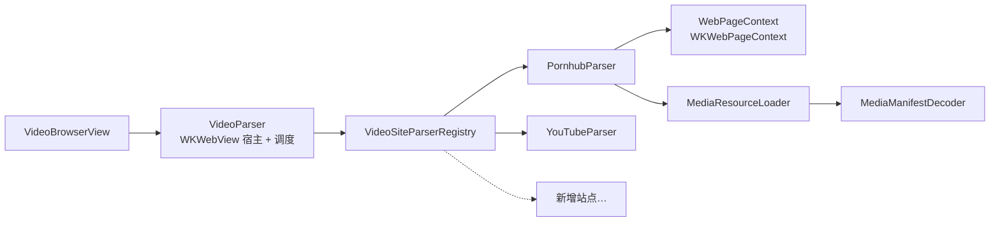

# Nox

一个 iOS 视频下载工具：内置浏览器打开视频页面，解析出可下载的清晰度，然后分片下载到本机，可通过「文件」App 访问。

- 版本：见仓库根目录 `VERSION`
- Bundle ID：`com.aholic.nox`
- 最低系统：iOS 17.0（仅 iPhone）
- 支持语言：简体中文、English、한국어、Français、Deutsch

---

## 功能

### 浏览

- 内置 `WKWebView`，顶部为胶囊形地址栏；页面向下滚动时地址栏自动收缩，回到顶部展开
- 地址栏为中间胶囊形输入框（支持一键清空），主页与书签各自是**独立**的圆形悬浮按钮分列两侧；地址栏会跟随页面内跳转 / 重定向 / 后退前进实时更新，**也包括 YouTube 这类单页应用**的 `pushState` 换页（靠注入脚本监听 history API 上报，不走导航回调）；用户正在输入时不覆盖；键盘「前往」即加载并收起键盘（无独立「打开」按钮）
- **首页**：未打开任何页面或点地址栏左侧主页按钮时，显示原生起始页（列出书签）；不再是一个白底空白页，深色模式下跟随系统配色
- **书签**：点地址栏右侧书签按钮收藏 / 取消收藏当前页面；首页列出全部书签，点即打开、左滑删除
- 「解析视频」与 Sniffer 入口都是右下角的液态玻璃悬浮胶囊，点击弹出半屏面板；两个半屏面板的列表样式一致（图标 + 标题/说明 + 下载图标、纯色文字、左滑复制链接）；解析面板右上角有「重新解析」，只刷新清晰度列表、不会自动开下；两者互斥：当前页面能被具名站点解析时只显示「解析视频」，否则只显示 Sniffer（仍受「解析来源」里的开关控制），任何页面都不会同时冒出两个入口
- 后退 / 前进使用系统边缘滑动手势，刷新使用下拉刷新（无独立按钮）
- 打开过的视频页面会记入历史；保留条数或保留天数可在「设置 → 历史记录」里配置
- 历史标题用下载文件名去掉扩展名；真正入队成功即记入历史，且**取消任务不会移除历史记录**（只有「只解析、不下载」才不记）
- 打开无效 / 被拒绝访问的地址时，页面区域会直接显示错误与「重试」，不再弹窗盖在旧页面上；从地址栏打开新地址时会先收起旧页面再显示加载状态

### 解析（可扩展的站点插件）

- 解析规则按站点实现，通过注册表按 URL 匹配，`VideoBrowserView` 等调用方无需改动
- 当前内置：Pornhub / Pornhub Premium / YouTube
- YouTube 走「页面播放器数据 → InnerTube」多来源尝试：页面把播放器数据压缩成直链字段回传；被风控（「确认你不是聊天机器人」）或被判「视频无法播放」时自动改用 Android VR / iOS / TV / WEB 客户端再试，任一来源拿到直链即可；WebView 使用完整的移动版 Safari UA，WEB 客户端请求带上 `SAPISIDHASH`（由页面 Cookie 算出），保证「已登录」状态被 YouTube 认到；每个来源的结果都会写进日志页（`youtube source …`），失败原因在解析面板里也会区分「被拦」「需要签名解密」「无数据」
- 每个站点在「设置 → 解析来源」里有独立开关；关闭后该站点的页面无法解析，解析入口不再出现
- 通用兜底解析器在界面里直接显示为 Sniffer
- 解析成功后可选清晰度，或按「设置 → 下载设置 → 下载清晰度」的偏好自动选择（每次询问 / 最佳 / 1080 / 720 / 480 / 360）

### 下载

- **断点续传**：先用 `Range: bytes=0-0` 探测服务器是否支持分段。支持则按字节分片下载，分片写在磁盘上，取消或失败后重试从断点继续；不支持则退化为单流整文件下载
- **多线程下载**（实验性）：可在 1–32 之间选择线程数（默认 4）
- **同时下载任务数**：1 / 3 / 5 / 10 / 20 / 无限制（默认 3）；m3u8 分片并发上限同样为 32
- 合并：分片按序拼接后先落到暂存目录，再整体移入 `Documents/`；合并**保证每个任务只执行一次**，中途被杀进程也不会残留半截成品（避免出现「同一任务多个大小/时长都不同的文件」）
- 续传保护：分片齐全但远端链接已失效（HTTP 4xx/5xx 或返回网页）时会判定失败，不会把错误页当成视频存下来（旧版本会误报成功）；拼接结果与预期大小不符或为空同样按失败处理
- 列表内实时显示「已下载 / 总大小 · 速度」；失败显示原因；取消显示「已暂停 · 已下载 X，重试可继续」；速度用「累计字节 + 单调时钟」在 6 秒滑动窗口内做首尾差分估算（`SpeedMeter`），对「时间断层」（切回前台 / 长期无数据）与「计数器回退」（重新开始任务）自动重置，不再出现后台期间的错误速度或残留旧值
- 启动时会扫描已完成的记录，若本地文件已被删除或清理，会在该条目标注红色「文件缺失」并隐藏分享入口
- 每条记录标题只占一行（超出用省略号），长按菜单顶部展示完整标题
- 双指下滑进入多选；只有从列表行上开始才触发，空白区域滑动不会进入选择模式；多选态右上角「删除」为红色文字
- 非多选态直接使用不带 selection 的列表，单击记录不会出现任何选中/变色高亮；多选只能通过「选择」或双指下滑进入
- 长按已完成条目可分享（系统分享面板），左滑删除单条，「清空」会同时删除记录、本地成品文件与未完成分片
- 历史页与下载页一致：左滑删除单条记录，长按菜单顶部展示完整标题

### 设置

- 顶部展示 App 图标与名称（随列表滚动）
- 设置项按功能分成尽可能少的组：内容与下载（下载设置 / 储存空间 / 解析来源 / Cookie 管理 / 历史记录 / 日志）、通用（外观 / 语言）
- 下载设置（二级页）：同时下载任务数、下载清晰度、多线程下载 / 下载线程数 / m3u8 分片并发
- 后台保活：相关设置收在二级页「后台保活」里。保活方式：关闭 / 静音音频 / 画中画 (PiP)（默认画中画），选中项即当前生效的保活方式；选画中画时还会多出「画中画窗口大小」滑块（最左 = 最小：窗口高 0.1pt、视觉隐藏、不影响操作；越往右窗口越大，最大 300×225）与「共存保护不可用时」——继续用画中画（可能挤掉其它画中画）/ 改用静音音频 / 停止保活（默认继续用画中画）。保活模式：跟随下载任务（默认，有「排队中 / 下载中」任务时自动开启、全部结束自动停止）/ 启动即常驻（只要保活方式不是「关闭」，进入前台即拉起并一直保持）；画中画不占用音频会话，切回前台若发现保活已被系统结束会自动重建
- 解析来源（二级页）：各站点与 Sniffer 的开关
- 储存空间（二级页）：按「已下载视频 / 下载分片 / 临时文件 / 网络缓存 / 网站数据」分类列出各自占用；已下载视频只统计 App 实际下载且文件仍在的成品，网络缓存按沙盒 `Library/Caches` 统计（不再恒为 0）；双指下滑进入多选，进入后返回键位置变为「完成」，右上角为刷新按钮（多选态下变为红色「清理」）
- Cookie 管理（二级页）：列出各站点保存的 Cookie 数量，可单独删除某个站点或一次清空；`WKWebView` 使用持久化数据存储，登录状态本就跨启动保留，这里用于查看与清理
- 历史记录（二级页）：保留方式（按条数 / 按时间），两种方式都可设为「无限制」
- 外观：跟随系统 / 浅色 / 深色；语言：App 内切换（不再额外显示提示小字）
- 日志（二级页）：查看运行日志（含版本、系统、下载与解析等细节），可选保留天数（含无限制）；日志按块加载，进入时只读最近一块，更早的用「加载更多」往前翻；支持清空与导出（系统分享面板）
- 版本不占行，在最后一组的页脚居中显示，形如 `Nox v1.0.16`
- 仅支持竖屏（iPhone 竖屏锁定）

### 文件访问

`Info.plist` 已开启 `UIFileSharingEnabled` 与 `LSSupportsOpeningDocumentsInPlace`，下载完成的视频可在「文件」App → 我的 iPhone → Nox 下直接查看、播放、导出。

---

## 目录结构

```
.
├── Info.plist                      # 真实生效的 Info.plist（GENERATE_INFOPLIST_FILE = NO）
├── VERSION                         # 版本号，CI 据此打 tag
├── .github/workflows/
│   ├── build-and-release.yml       # 合并到 main 后构建无签名 IPA 并发 Release
│   └── build-dev.yml               # 推送到 dev 时编译并打包无签名 IPA，上传为 Actions 工件；仅改 VERSION 的推送不触发
├── Nox/
│   ├── NoxApp.swift                # @main，注入语言环境
│   ├── ContentView.swift           # TabView：浏览 / 下载 / 历史 / 设置
│   ├── Models.swift                # 领域模型、错误、传输统计
│   ├── AppState.swift              # 全局状态与持久化；AppLocale / L(_:) / 语言管理
│   ├── VideoParser.swift           # WKWebView 宿主 + 解析调度
│   ├── Parsers/
│   │   ├── VideoSiteParser.swift           # 协议、页面上下文、通用请求与清单解析
│   │   ├── VideoSiteParserRegistry.swift   # 站点注册表
│   │   ├── PornhubParser.swift             # Pornhub 解析实现
│   │   └── YouTubeParser.swift             # YouTube 解析实现（页面/InnerTube 取直链）
│   ├── DownloadManager.swift       # 分片下载、续传、合并、进度统计
│   ├── VideoBrowserView.swift      # 浏览页
│   ├── DownloadsView.swift         # 下载页
│   ├── HistoryView.swift           # 历史页
│   ├── SettingsView.swift          # 设置页 + 下载设置 / 解析来源 / 储存空间二级页
│   ├── Localizable.xcstrings       # 字符串目录（5 种语言）
│   └── Assets.xcassets/            # AppIcon 与设置页用的 AppIconPreview
└── Nox.xcodeproj/                  # 手写工程文件
```

---

## 构建

### 本地（Xcode）

1. 用 Xcode 26 打开 `Nox.xcodeproj`
2. 选择 `Nox` scheme 与目标设备
3. 首次运行需在 Signing & Capabilities 里填入自己的 `DEVELOPMENT_TEAM`（仓库中为空）

### 本地 / CI（命令行，无签名）

```bash
xcodebuild \
  -project Nox.xcodeproj \
  -scheme Nox \
  -sdk iphoneos \
  -configuration Release \
  -destination 'generic/platform=iOS' \
  -derivedDataPath build/DerivedData \
  MARKETING_VERSION=0.0.0 \
  CURRENT_PROJECT_VERSION=1 \
  CODE_SIGNING_ALLOWED=NO \
  CODE_SIGNING_REQUIRED=NO \
  build
```

产物位于 `build/DerivedData/Build/Products/Release-iphoneos/Nox.app`。

自定义校验（可选，能提前暴露资源与工程配置问题）：

```bash
plutil -lint Info.plist

APP=build/DerivedData/Build/Products/Release-iphoneos/Nox.app
ls "$APP" | grep lproj   # 期望 5 个：de en fr ko zh-Hans
plutil -p "$APP/Info.plist" | grep -E "CFBundleDisplayName|CFBundleIdentifier"
```

### 发布流程

**dev 分支**：`.github/workflows/build-dev.yml` 在 **推送到 `dev`**（或手动触发）时用 `Debug` 配置编译，并打包为 `Nox-<version>-dev<run_number>-unsigned.ipa`，作为 **Actions 工件**（artifact，保留 14 天）供下载；**不创建 Release、不打 tag**。同一分支的新推送会取消进行中的旧构建。**只改动 `VERSION` 的推送不会触发**（`paths-ignore`），若同一次推送还改了别的文件则照常触发；手动触发不受该过滤影响。

**发布**：`.github/workflows/build-and-release.yml` 在 **PR 合并进 `main`** 时触发：

1. 校验 `Info.plist`（`plutil -lint`，并断言 `UIFileSharingEnabled` / `LSSupportsOpeningDocumentsInPlace` 为布尔 `true`）
2. 读取 `VERSION`，校验 semver，生成 tag `v<VERSION>`
3. 若该 tag 已存在则整体跳过（**不会重复发布**）
4. 以 `VERSION` 作为 `MARKETING_VERSION`、以 run number 作为 `CURRENT_PROJECT_VERSION` 构建无签名 App
5. 打包为 `Nox-<VERSION>-unsigned.ipa`，计算 SHA256
6. 用 PR 描述 + SHA256 作为正文创建 GitHub Release

因此：**每次发版前必须 bump `VERSION`**，否则 tag 已存在会被跳过。

> 无签名 IPA 需自行签名（AltStore / SideStore / TrollStore / 开发者证书重签等）后才能安装。

---

## 架构要点

### 站点解析是可插拔的



`VideoSiteParser` 定义单个站点的规则，`WebPageContext` 把 `WKWebView` 隔离在协议之后，`MediaResourceLoader` / `MediaManifestDecoder` 提供多数站点通用的"带 Referer/Cookie 请求清单 → 解析清晰度"流程。

**新增一个站点：**

1. 在 `Nox/Parsers/` 新建 `XxxParser.swift`：

```swift
import Foundation

@MainActor
final class XxxParser: VideoSiteParser {
    // 稳定标识，用于持久化开关状态；一经发布不要再改
    let identifier = "xxx"
    let displayName = "XXX"

    func canHandle(_ url: URL) -> Bool {
        guard url.scheme == "https", let host = url.host else { return false }
        return host == "xxx.com" || host.hasSuffix(".xxx.com")
    }

    func parse(page: WebPageContext) async throws -> [VideoVariant] {
        // 1) page.evaluate(js) 从页面取数据
        // 2) 需要额外请求用 MediaResourceLoader.fetch(...)
        // 3) 结构是 [{ videoUrl, quality, format }] 时用 MediaManifestDecoder.variants(from:)
        // 4) 都不符合时抛 ParserError 中最贴近的 case
        throw ParserError.noMediaDefinitions
    }
}
```

2. 在 `VideoSiteParserRegistry.swift` 的 `all` 里追加 `XxxParser(),`
3. 把新文件加入 `Nox.xcodeproj` 的 `Nox` 组与 target（Xcode 里拖入勾选 target 即可；本项目是手写 pbxproj，不会自动同步目录）

设置页的站点开关会自动出现，`VideoParser`、各视图无需改动。

### 分片下载

- 分片边界是 `(总大小, 分片数)` 的纯函数结果，只要这两个值不变，重启后算出的边界必然一致 → 可以安全续传
- 分片与暂存位于 `Application Support/Nox/`（用户不可见，也不会被系统当作缓存清理）；成品在 `Documents/`
- 数据库（`UserDefaults`）中**只存文件名**，不存绝对路径 —— 沙盒容器路径会随重装/更新变化
- 高频进度回调只改内存（`updateDownload(_:persist: false)`），不每次写 `UserDefaults`

### 后台保活

- 抽成 `KeepAliveStrategy`（`SilentAudioKeepAlive` / `PictureInPictureKeepAlive`），由 `KeepAliveCoordinator` 统一调度：按「保活模式」决定 —— 跟随下载任务（有「排队中 / 下载中」任务就开启，全部结束就停止）或启动即常驻（进入前台就拉起并保持，直到把保活方式设为「关闭」）；失败或被打断只记录原因，**既不自动切换到别的保活方式**（避免静默改用会打断其它音频的静音音频）**也不自动重试**，等回到前台由 `didEnterForeground()` 重建
- 画中画启动由 KVO + 有界重试驱动：`isPictureInPicturePossible` 刚创建时可能是**瞬时 true**（随后系统才算出真值），直接据此启动会「把其他 App 的画中画挤掉、自己却起不来」；因此要求连续两次为 true 才真正 `startPictureInPicture()`，未就绪时以固定间隔有限次重试（约 12 秒封顶），仍失败才上报「启动失败」
- 画中画走 `AVPictureInPictureVideoCallViewController` + `activeVideoCallSourceView`，内容完全透明，不申请音频会话，因此不打断其他 App 的音频；悬浮窗尺寸由「画中画窗口大小」滑块控制：宽度固定 300pt、高度 0.1…225pt（最左 0.1pt 即视觉隐藏）；调节时只即时更新宿主视图尺寸，**不重建画中画会话**（刚停掉就重启常被系统拒绝，会让保活失效）
- 共存保护装不上时按用户在设置里的选择处理（继续用画中画 / 改用静音音频 / 停止保活），不再默认静默退回普通画中画
- 共存保护 `PiPCoexistenceProtection` 对齐参考实现（GlobalRefresh-PiP 1.1.1）：按 `platformAdapter` / `pegasusProxy` 选择器找内部对象，在 adapter 类上安装实例级 provider `pictureInPictureProxyContentType:`（并 hook `respondsToSelector:`）并挂好实例配置，**必须在惰性取得 `pegasusProxy` 之前完成**（顺序反了，本次会话仍是普通 PiP —— 表现就是启动保活时挤掉其他 App 的画中画）；首次启动用内容类型 4、`didStart` 后延迟 0.3 秒提交 6；所有调用都先做运行时签名校验，校验不通过即静默跳过
- 启动是异步的：画中画启动后做一次「一次性」核对，若长时间未进入激活状态会上报「启动失败」；「启动失败」与「启动后被系统/用户结束」分开处理，但都只记录原因、不做自动重试，等回到前台由 `didEnterForeground()` 重建
- 每次「有活跃任务」状态变化（继续 / 重试任务）都会按策略的**真实存活状态**自愈：若 `activeMode` 记录还在但 PiP 其实已经掉了，会先归零再重建，避免「重试任务时拉不起保活」
- 宿主窗口不再强求 key window（后台 / 弹 sheet 时可能没有）：退化为「任意一个可见窗口」，拿不到宿主只算暂时失败，等回到前台重建
- 保活启停由 `DownloadManager` 订阅 `AppState.$downloads` 驱动，不在每个状态迁移点手写调用，避免漏掉而「任务都结束了保活还开着」
- 需要在 `Info.plist` 开启 `UIBackgroundModes: audio`

### 下载速度估算

- `SpeedMeter` 只依赖「累计字节数」与「单调时钟」（`ProcessInfo.systemUptime`）两个输入，在滑动窗口内取首尾样本差分，天生平滑，不依赖逐帧瞬时值
- 相邻采样间隔超过阈值即判定「时间断层」（切后台后定时器停摆、长期无数据），清空窗口重新取样，绝不把断层时长当分母
- 累计字节回退（重新开始任务）自动重置；没有新字节时速度自然回落到 0，无需额外衰减逻辑

---

## 本地化

文案集中在 `Nox/Localizable.xcstrings`（字符串目录），`sourceLanguage` 为 `zh-Hans`。

代码里**必须**用显式查表函数 `L(_:)`，不能用字面量：

```swift
// ✅ 会按 App 内选择的语言查表
Text(L("设置"))
Button(L("清空")) { … }
Label(L("解析视频"), systemImage: "arrow.down.circle")
.navigationTitle(L("下载"))

// ✅ 带插值
String(format: L("页面加载失败：%@"), message)

// ❌ 这些走 Bundle.main（系统语言），App 内切换语言不会生效
Text("设置")
String(localized: "设置")
String(localized: "页面加载失败：\(message)")
```

**任何使用 `L(...)` 的视图都需要观察语言变化**，否则切换语言后界面不会重算：

```swift
@ObservedObject private var localization = LocalizationManager.shared
```

**新增文案**：手写加入 `Localizable.xcstrings` 的对应语言列。因为 `L(_:)` 的参数是变量，Xcode 无法自动提取，不会像 `Text("字面量")` 那样自动出现在待翻译列表里。

### 新增语言

1. `Localizable.xcstrings` 里为每个键补该语言的 `localizations` 条目
2. `AppState.swift` 的 `AppLanguage` 增加 case（`rawValue` 必须等于 `.lproj` 目录名）
3. `Info.plist` 的 `CFBundleLocalizations` 加入该语言代码
4. `project.pbxproj` 的 `knownRegions` 加入该语言代码

App 内可切换语言或选择「跟随系统」；系统语言不在支持列表时回落到 `CFBundleDevelopmentRegion`。

---

## 已知限制

- **后台保活依赖 `UIBackgroundModes: audio`**：静音音频与画中画保活都需要它，系统仍可能在极端情况下回收 App；被回收后重试即可续传。静音音频会占用音频会话，可能打断其他 App 正在播放的音频，因此默认为画中画
- **画中画「共存保护」使用系统内部接口**（`setContentType:` 一族，见 `docs/DEVELOPMENT_PRD.md`）：运行时做了能力与签名校验、校验不通过即跳过，但上架有被拒风险，系统升级也可能失效
- **后台会话缺少 `AppDelegate` 回调**：`URLSessionConfiguration.background` + `sessionSendsLaunchEvents = true` 需要在系统唤醒 App 时处理 `application(_:handleEventsForBackgroundURLSession:completionHandler:)`，当前未实现，`urlSessionDidFinishEvents(forBackgroundURLSession:)` 为空。App 被挂起后下载可能暂停，重试即可续传
- **服务器不支持 `Range` 时无法续传**，且总大小未知，进度只显示已下载量与速度
- **`PRODUCT_BUNDLE_IDENTIFIER` 一旦对外发布不要修改**，否则等同换一个 App，沙盒数据（下载记录、设置、Documents 内的视频）不会继承
- 下载能力由站点解析结果决定，本仓库仅包含站点适配逻辑，不提供任何内容