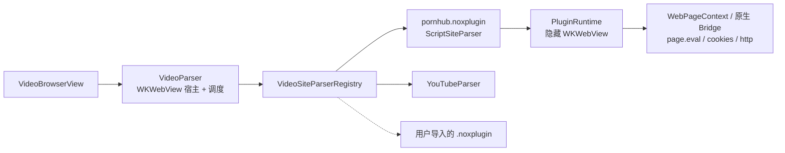

# Nox

一个 iOS 视频下载工具：内置浏览器打开视频页面，解析出可下载的清晰度，然后分片下载到本机，可通过「文件」App 访问。

- 版本：见仓库根目录 `VERSION`
- Bundle ID：`com.aholic.nox`
- 最低系统：iOS 17.0（仅 iPhone）
- 支持语言：简体中文、English、한국어、Français、Deutsch

---

## 功能

### 浏览

- 内置 `WKWebView`，顶部为胶囊形地址栏；页面向下滚动时地址栏自动收缩，回到顶部展开
- 地址栏为中间胶囊形输入框（支持一键清空），主页与书签各自是**独立**的圆形悬浮按钮分列两侧；地址栏会跟随页面内跳转 / 重定向 / 后退前进实时更新，**也包括 YouTube 这类单页应用**的 `pushState` 换页（靠注入脚本监听 history API 上报，不走导航回调）；用户正在输入时不覆盖；键盘「前往」即加载并收起键盘（无独立「打开」按钮）
- **首页**：未打开任何页面或点地址栏左侧主页按钮时，显示原生起始页（列出书签）；不再是一个白底空白页，深色模式下跟随系统配色
- **书签**：点地址栏右侧书签按钮收藏 / 取消收藏当前页面；首页列出全部书签，点即打开、左滑删除
- 「解析视频」与 Sniffer 入口都是右下角的液态玻璃悬浮胶囊，点击弹出半屏面板；两个半屏面板的列表样式一致（图标 + 标题/说明 + 下载图标、纯色文字、左滑复制链接）；解析面板右上角有「重新解析」，只刷新清晰度列表、不会自动开下；两者互斥：当前页面能被具名站点解析时只显示「解析视频」，否则只显示 Sniffer（仍受「解析来源」里的开关控制），任何页面都不会同时冒出两个入口
- 后退 / 前进使用系统边缘滑动手势，刷新使用下拉刷新（无独立按钮）
- 地址栏带加载提示：加载中时胶囊右侧的「清空」换成转圈，同时地址栏下沿浮出一条细进度条（进度起步时给一个可见下限，加载完成补满一格再淡出），加载期间周期性明暗呼吸 —— 呼吸亮度由时钟直接算出来，不会被淡入 / 淡出的动画顶掉。真实换页走 `WKWebView.estimatedProgress`；单页应用只改 path 的同文档换页没有任何导航回调与进度，改由注入脚本按「path/query 变化 → 一段最短显示时间 → 连续 600ms 无新资源请求」上报，那一段固定显示约 1/3 宽。在页面里点链接换页时旧页面会一直留到新页面提交，这条进度条是那一刻唯一「正在加载」的反馈
- 打开过的视频页面会记入历史；保留条数或保留天数可在「设置 → 历史记录」里配置
- 历史标题用下载文件名去掉扩展名；真正入队成功即记入历史，且**取消任务不会移除历史记录**（只有「只解析、不下载」才不记）
- 打开无效 / 被拒绝访问的地址时，页面区域会直接显示错误与「重试」，不再弹窗盖在旧页面上；从地址栏打开新地址时会先收起旧页面再显示加载状态
- **接收外部网页链接**：在 Safari 或其他 App 的分享面板中选择 Nox，即可把当前网页链接交给 Nox 并直接在浏览页打开；也注册了 `nox://` URL Scheme，快捷指令或自动化可调用 `nox://open?url=<百分号编码的网页地址>`。只接受 `http` / `https`，不会把 `javascript:` 等地址交给 WebView

### 解析（可扩展的站点插件）

- 单文件插件规范（草案）：[`docs/PLUGIN_SPEC.md`](docs/PLUGIN_SPEC.md)
- 解析规则按站点实现，通过注册表按 URL 匹配，`VideoBrowserView` 等调用方无需改动
- 当前内置：YouTube（原生）、Pornhub / Pornhub Premium（单文件插件 `Nox/Resources/pornhub.noxplugin`）；包内插件启动时自动加载，用户也可以从「文件」App、AirDrop 或其他 App 的「用 Nox 打开」导入 `.noxplugin`，导入后立即出现在解析来源并生效。导入时会校验扩展名、大小、UTF-8、元数据与 JavaScript 语法，但不会执行插件代码
- YouTube 走「页面播放器数据 → InnerTube」多来源尝试：页面把播放器数据压缩成直链字段回传；被风控（「确认你不是聊天机器人」）或被判「视频无法播放」时自动改用 Android VR / iOS / TV / WEB 客户端再试，任一来源拿到直链即可；WebView 使用完整的移动版 Safari UA，WEB 客户端请求带上 `SAPISIDHASH`（由页面 Cookie 算出），保证「已登录」状态被 YouTube 认到；每个来源的结果都会写进日志页（`youtube source …`），失败原因在解析面板里也会区分「被拦」「需要签名解密」「无数据」
- 每个站点在「设置 → 解析来源」里有独立开关；关闭后该站点的页面无法解析，解析入口不再出现。列表顺序就是匹配优先级，可拖动调整；所有单文件插件（包括随 App 分发的 Pornhub）都支持长按导出 / 删除，内置插件删除后只是从本机隐藏，可在右上角菜单恢复
- 通用兜底解析器在界面里直接显示为 Sniffer
- 解析成功后可选清晰度，或按「设置 → 下载设置 → 下载清晰度」的偏好自动选择（每次询问 / 最佳 / 1080 / 720 / 480 / 360）

### 下载

- **断点续传**：先用 `Range: bytes=0-0` 探测服务器是否支持分段。支持则按字节分片下载，分片写在磁盘上，取消或失败后重试从断点继续；不支持则退化为单流整文件下载
- **多线程下载**（实验性）：可在 1–32 之间选择线程数（默认 4）
- **同时下载任务数**：1 / 3 / 5 / 10 / 20 / 无限制（默认 3）；m3u8 分片并发上限同样为 32
- **下载网络**：可选「无线局域网与蜂窝」或「仅无线局域网」。选后者时，探测、普通分片、m3u8 清单 / 密钥 / 分片请求都不会使用蜂窝流量；离开 Wi-Fi 后下载中断，重新连接后点「继续下载」即可断点续传
- 合并：分片按序拼接后先落到暂存目录，再整体移入 `Documents/`；合并**保证每个任务只执行一次**，中途被杀进程也不会残留半截成品（避免出现「同一任务多个大小/时长都不同的文件」）
- 续传保护：分片齐全但远端链接已失效（HTTP 4xx/5xx 或返回网页）时会判定失败，不会把错误页当成视频存下来（旧版本会误报成功）；拼接结果与预期大小不符或为空同样按失败处理
- 列表内实时显示「已下载 / 总大小 · 速度」；失败显示原因；取消显示「已暂停 · 已下载 X，重试可继续」；速度用「累计字节 + 单调时钟」在 6 秒滑动窗口内做首尾差分估算（`SpeedMeter`），对「时间断层」（切回前台 / 长期无数据）与「计数器回退」（重新开始任务）自动重置，不再出现后台期间的错误速度或残留旧值
- 启动时会扫描已完成的记录，若本地文件已被删除或清理，会在该条目标注红色「文件缺失」并隐藏分享入口
- 每条记录标题只占一行（超出用省略号），长按菜单顶部展示完整标题
- 双指下滑进入多选；只有从列表行上开始才触发，空白区域滑动不会进入选择模式。非多选态右上角是「全部继续 / 全部暂停 / 清空」多功能菜单，直接作用于全部状态适用的任务（失败/已暂停可继续、排队中/下载中可暂停），没有适用任务时对应项置灰；多选时隐藏底部标签栏，左上角为主题色对号「完成」，右上角仍是多功能菜单，左下角为玻璃按钮「全选 / 取消全选」，右下角为红色删除按钮。多选态的多功能菜单集中「重试 / 继续下载」「暂停」「分享」「清空」，没有选中项时也会展开，只是批量操作置灰。每个操作只作用于选中项里状态适用的记录（失败/已暂停可重试、排队中/下载中可暂停、已完成且文件在分享），执行后自动退出多选。iOS 26 使用系统液态玻璃按钮，低版本回退为材质浮层
- 非多选态直接使用不带 selection 的列表，单击记录不会出现任何选中/变色高亮；多选可通过「选择」或双指下滑进入
- 长按已完成条目可分享（系统分享面板），左滑删除单条，「清空」会同时删除记录、本地成品文件与未完成分片
- 历史页与下载页一致：左滑删除单条记录，长按菜单顶部展示完整标题

### 设置

- 顶部展示 App 图标与名称（随列表滚动）
- 所有设置项收在同一组里（尽量少的组）：下载设置 / 储存空间 / 解析来源 / Cookie 管理 / 历史记录 / 日志 / 后台保活 / 开源许可与致谢 / 外观 / 语言
- 下载设置（二级页）：同时下载任务数、下载清晰度、多线程下载 / 下载线程数 / m3u8 分片并发
- 后台保活：相关设置收在二级页「后台保活」里。保活方式：关闭 / 静音音频 / 画中画 (PiP)（默认画中画），选中项即当前生效的保活方式；选画中画时还会多出「画中画窗口大小」滑块（最左 = 最小：窗口高 0.1pt、视觉隐藏、不影响操作；越往右窗口越大，最大 300×225）与「共存保护不可用时」——继续用画中画（可能挤掉其它画中画）/ 改用静音音频 / 停止保活（默认继续用画中画）。保活模式：跟随下载任务（默认，有「排队中 / 下载中」任务时自动开启、全部结束自动停止）/ 启动即常驻（只要保活方式不是「关闭」，进入前台即拉起并一直保持）；画中画不占用音频会话，切回前台若发现保活已被系统结束会自动重建
- 解析来源（二级页）：各站点与内置通用嗅探的开关；列表从上到下即匹配优先级（内置通用嗅探固定最后），右上角菜单可导入插件、进入排序或恢复默认顺序；排序时隐藏开关，只保留拖动手柄。长按任意单文件插件可导出或删除；用户导入的版本优先，删除后若包内存在同 ID 插件会自动回落，内置插件删除后可通过右上角菜单恢复
- 储存空间（二级页）：按「已下载视频 / 下载分片 / 临时文件 / 网络缓存 / 网站数据」分类列出各自占用；已下载视频只统计 App 实际下载且文件仍在的成品，网络缓存按沙盒 `Library/Caches` 统计（不再恒为 0）；双指下滑进入多选，进入后返回键位置变为「完成」，右上角为刷新按钮（多选态下变为红色「清理」）
- Cookie 管理（二级页）：列出各站点保存的 Cookie 数量，可单独删除某个站点或一次清空；`WKWebView` 使用持久化数据存储，登录状态本就跨启动保留，这里用于查看与清理
- 历史记录（二级页）：保留方式（按条数 / 按时间），两种方式都可设为「无限制」
- 外观：跟随系统 / 浅色 / 深色；语言：App 内切换（不再额外显示提示小字）
- 日志（二级页）：查看运行日志（含版本、系统、下载与解析等细节），可选保留天数（含无限制）；日志按块加载，进入时只读最近一块，更早的用「加载更多」往前翻；支持清空与导出（系统分享面板）
- 版本与作者不占行，在最后一组的页脚居中显示，形如 `Nox v1.0.16 · Aholic`
- 开源许可与致谢（二级页）：列出本项目参考 / 复用的来源（CaiWanFeng/PiP、Yoroin/GlobalRefresh-PiP）及各自作者、用途与仓库链接，并附免责声明；仓库根目录的 `NOTICE` 是该署名要求的正式版本
- 仅支持竖屏（iPhone 竖屏锁定）

### 文件访问

`Info.plist` 已开启 `UIFileSharingEnabled` 与 `LSSupportsOpeningDocumentsInPlace`，下载完成的视频可在「文件」App → 我的 iPhone → Nox 下直接查看、播放、导出。

### 外部链接与分享扩展

- **从分享面板接收**：`NoxShare` Share Extension 支持网页 URL、网页与纯文本链接。选择 Nox 后，扩展读取链接、生成 `nox://open?url=...`，切回宿主 App 并直接加载页面。
- **通过 URL Scheme 接收**：主 App 的 `Info.plist` 注册了 `nox`。网页地址需要作为 `url` 查询参数传入，并进行百分号编码：

```text
nox://open?url=https%3A%2F%2Fexample.com%2Fwatch%3Fv%3D1
```

在快捷指令中，可直接用「URL」动作构造上述地址，再用「打开 URL」动作启动 Nox。收到网页链接后会切换到浏览标签页并加载网页；普通文件链接仍走既有的 `.noxplugin` 导入流程。

> Apple 没有向 Share Extension 开放官方的「打开宿主 App」API。这里先调用 `NSExtensionContext.open(_:)`，失败时使用 responder chain 兼容路径；两条路径都不可用时会把链接复制到剪贴板并提示手动打开。该兼容路径适合自签 / 侧载构建，若计划上架 App Store 需要重新评估。

---

## 目录结构

```
.
├── Info.plist                      # 主 App 的 Info.plist（GENERATE_INFOPLIST_FILE = NO）
├── NoxShare-Info.plist             # Share Extension 的 Info.plist
├── VERSION                         # 版本号，CI 据此打 tag
├── NOTICE                          # 第三方署名与免责声明（PiP / GlobalRefresh-PiP）
├── .github/workflows/
│   ├── build-and-release.yml       # 合并到 main 后构建无签名 IPA 并发 Release
│   └── build-dev.yml               # 推送到 dev 时编译并打包无签名 IPA，上传为 Actions 工件
├── Nox/
│   ├── NoxApp.swift                # @main，注入语言环境
│   ├── AppWiring.swift             # 依赖装配
│   ├── ContentView.swift           # TabView：浏览 / 下载 / 历史 / 设置
│   ├── IncomingLink.swift          # nox:// 与网页链接解析
│   ├── PluginImportCoordinator.swift # 外部文件导入与结果提示
│   ├── Resources/
│   │   ├── Localizable.xcstrings   # 字符串目录（5 种语言）
│   │   ├── MediaSniffer.js         # 页面嗅探脚本
│   │   ├── pornhub.noxplugin       # Pornhub 单文件插件（运行时加载）
│   │   └── Assets.xcassets/        # AppIcon 与设置页预览图
│   └── Views/                      # Browser / Downloads / History / Settings / Sniffer
├── NoxShare/
│   ├── ShareViewController.swift   # 从系统分享面板接收链接并切回宿主 App
│   └── Localizable.xcstrings       # 分享扩展文案（5 种语言）
├── NoxKit/
│   ├── Package.swift               # 本地 SPM 模块
│   └── Sources/
│       ├── NoxCore/                # 模型、日志、本地化、存储路径
│       ├── NoxParsing/
│       │   ├── Plugins/            # .noxplugin 解析、校验、运行时与 Bridge
│       │   ├── Sniffer/            # 通用嗅探
│       │   ├── YouTube/            # YouTube 原生解析
│       │   └── VideoSiteParser*.swift
│       ├── NoxBrowser/             # WKWebView 宿主与解析调度
│       ├── NoxDownload/            # 分片下载、续传、合并
│       ├── NoxKeepAlive/           # 后台保活策略
│       └── NoxState/               # 全局 AppState
├── docs/
│   ├── PLUGIN_SPEC.md              # 单文件插件规范
│   └── examples/                   # 示例插件
└── Nox.xcodeproj/                  # 工程文件
```

---

## 构建

### 本地（Xcode）

1. 用 Xcode 26 打开 `Nox.xcodeproj`
2. 选择 `Nox` scheme 与目标设备
3. 首次运行需在 Signing & Capabilities 里填入自己的 `DEVELOPMENT_TEAM`（仓库中为空）

### 本地 / CI（命令行，无签名）

```bash
xcodebuild \
  -project Nox.xcodeproj \
  -scheme Nox \
  -sdk iphoneos \
  -configuration Release \
  -destination 'generic/platform=iOS' \
  -derivedDataPath build/DerivedData \
  MARKETING_VERSION=0.0.0 \
  CURRENT_PROJECT_VERSION=1 \
  CODE_SIGNING_ALLOWED=NO \
  CODE_SIGNING_REQUIRED=NO \
  build
```

产物位于 `build/DerivedData/Build/Products/Release-iphoneos/Nox.app`。

自定义校验（可选，能提前暴露资源与工程配置问题）：

```bash
plutil -lint Info.plist

APP=build/DerivedData/Build/Products/Release-iphoneos/Nox.app
ls "$APP" | grep lproj   # 期望 5 个：de en fr ko zh-Hans
plutil -p "$APP/Info.plist" | grep -E "CFBundleDisplayName|CFBundleIdentifier"
```

### 发布流程

**dev 分支**：`.github/workflows/build-dev.yml` 在 **推送到 `dev`**（或手动触发）时用 `Debug` 配置编译，并打包为 `Nox-<version>-dev<run_number>-unsigned.ipa`，作为 **Actions 工件**（artifact，保留 14 天）供下载；**不创建 Release、不打 tag**。同一分支的新推送会取消进行中的旧构建。**只改动 `VERSION` 的推送不会触发**（`paths-ignore`），若同一次推送还改了别的文件则照常触发；手动触发不受该过滤影响。

**发布**：`.github/workflows/build-and-release.yml` 在 **PR 合并进 `main`** 时触发：

1. 校验 `Info.plist`（`plutil -lint`，并断言 `UIFileSharingEnabled` / `LSSupportsOpeningDocumentsInPlace` 为布尔 `true`）
2. 读取 `VERSION`，校验 semver，生成 tag `v<VERSION>`
3. 若该 tag 已存在则整体跳过（**不会重复发布**）
4. 以 `VERSION` 作为 `MARKETING_VERSION`、以 run number 作为 `CURRENT_PROJECT_VERSION` 构建无签名 App
5. 打包为 `Nox-<VERSION>-unsigned.ipa`，计算 SHA256
6. 用 PR 描述 + SHA256 作为正文创建 GitHub Release

因此：**每次发版前必须 bump `VERSION`**，否则 tag 已存在会被跳过。

> 无签名 IPA 需自行签名（AltStore / SideStore / TrollStore / 开发者证书重签等）后才能安装。

---

## 架构要点

### 站点解析是可插拔的



`VideoSiteParser` 定义单个站点的规则，`WebPageContext` 把 `WKWebView` 隔离在协议之后。Pornhub 已迁为单文件插件：`PluginPackage` 解析元数据，`ScriptSiteParser` 适配现有注册表，`PluginRuntime` 在独立 `WKWebView` 中执行 JavaScript，并通过 Bridge 访问页面、Cookie 和网络。YouTube 暂时保留原生实现。

**新增一个站点：**

优先写单文件插件，不需要改 Swift 工程：

1. 按 [`docs/PLUGIN_SPEC.md`](docs/PLUGIN_SPEC.md) 写一个 `.noxplugin`
2. 把文件放进 `Nox/Resources/`（`.noxplugin` 会自动作为资源拷贝进 App），或直接发给用户从「文件」App 导入
3. 包内插件启动时由 `BundledPluginLoader` 加载；用户插件由 `PluginStore` 校验后保存到沙箱并触发表刷新，设置页与解析调度自动出现该站点

只有确实需要原生能力（例如 YouTube 的 InnerTube 多来源与签名解密）时才新增 `VideoSiteParser` 实现，并加入 `VideoSiteParserRegistry`。

### 分片下载

- 分片边界是 `(总大小, 分片数)` 的纯函数结果，只要这两个值不变，重启后算出的边界必然一致 → 可以安全续传
- 分片与暂存位于 `Application Support/Nox/`（用户不可见，也不会被系统当作缓存清理）；成品在 `Documents/`
- 数据库（`UserDefaults`）中**只存文件名**，不存绝对路径 —— 沙盒容器路径会随重装/更新变化
- 高频进度回调只改内存（`updateDownload(_:persist: false)`），不每次写 `UserDefaults`

### 后台保活

- 抽成 `KeepAliveStrategy`（`SilentAudioKeepAlive` / `PictureInPictureKeepAlive`），由 `KeepAliveCoordinator` 统一调度：按「保活模式」决定 —— 跟随下载任务（有「排队中 / 下载中」任务就开启，全部结束就停止）或启动即常驻（进入前台就拉起并保持，直到把保活方式设为「关闭」）；失败或被打断只记录原因，**既不自动切换到别的保活方式**（避免静默改用会打断其它音频的静音音频）**也不自动重试**，等回到前台由 `didEnterForeground()` 重建
- 画中画启动由 KVO + 有界重试驱动：`isPictureInPicturePossible` 刚创建时可能是**瞬时 true**（随后系统才算出真值），直接据此启动会「把其他 App 的画中画挤掉、自己却起不来」；因此要求连续两次为 true 才真正 `startPictureInPicture()`，未就绪时先以 0.8 秒间隔快速重试 5 次、之后每 3 秒继续等（**不放弃会话**，只是降速），避免「取消任务后再继续就永远拉不起来」
- 画中画只在 App **前台激活**时才启动（用 `UIApplication.shared.applicationState == .active` 判定）：冷启动时 `DownloadManager` 初始化会同步设置保活模式并触发一次启动，而那一刻 App 还没激活，`startPictureInPicture()` 会被系统以 `AVKitErrorDomain -1001` 拒绝；现在这种启动会被推迟，等 `didEnterForeground()` 在 App 激活后再拉起
- `startPictureInPicture()` 调用后到结果返回之前不会重复调用（用 `isStartPending` 标记）：重复调用同样会被系统以 `AVKitErrorDomain -1001` 拒绝
- 画中画走 `AVPictureInPictureVideoCallViewController` + `activeVideoCallSourceView`，内容完全透明，不申请音频会话，因此不打断其他 App 的音频；悬浮窗尺寸由「画中画窗口大小」滑块控制：宽度固定 300pt、高度 0.1…225pt（最左 0.1pt 即视觉隐藏）；调节时只即时更新宿主视图尺寸，**不重建画中画会话**（刚停掉就重启常被系统拒绝，会让保活失效）。画中画会话（controller + 宿主视图）整个 App 生命周期**只建一次、跨启停复用**：任务结束只调 `stopPictureInPicture()` 暂停、不销毁基础设施，下次启动直接复用同一个会话 —— 拆掉重建会让系统以 `AVKitErrorDomain -1001` 拒绝新建；宿主视图常驻窗口但 `isUserInteractionEnabled = false`，不挡手势
- 共存保护装不上时按用户在设置里的选择处理（继续用画中画 / 改用静音音频 / 停止保活），不再默认静默退回普通画中画
- 共存保护 `PiPCoexistenceProtection` 对齐参考实现（GlobalRefresh-PiP 1.1.1）：按 `platformAdapter` / `pegasusProxy` 选择器找内部对象，在 adapter 类上安装实例级 provider `pictureInPictureProxyContentType:`（并 hook `respondsToSelector:`）并挂好实例配置，**必须在惰性取得 `pegasusProxy` 之前完成**（顺序反了，本次会话仍是普通 PiP —— 表现就是启动保活时挤掉其他 App 的画中画）；首次启动用内容类型 4、`didStart` 后延迟 0.3 秒提交 6；所有调用都先做运行时签名校验，校验不通过即静默跳过
- 启动是异步的：画中画启动后做一次「一次性」核对（窗口 8 秒 —— 太短会把「只是慢一点、马上就会激活」的会话直接掐掉，表现为「拉起画中画失败」），若始终未进入激活状态就走有界退避重试（2 / 4 / 6 / 8 秒，共 4 次），仍失败才上报「启动失败」；系统主动拒绝时会连同 `NSError` 的 domain / code / 描述一起写进日志；「启动失败」与「启动后被系统/用户结束」分开处理：前者在会话内部退避重试，后者只记录原因、不自动重试，等回到前台由 `didEnterForeground()` 重建
- 每次「有活跃任务」变化都走一遍 reconcile（**即使活跃数没变也走**），按策略的**真实存活状态**自愈：若 `activeMode` 记录还在但 PiP 其实已经掉了，会先归零再重建，避免「重试任务时拉不起保活」；用户点「继续 / 重试」时还会额外主动检查一次（`retryKeepAlive()`）。反过来，若目标策略其实还在运行而记录停在了 `.off`，只同步记录、不做「停掉再立刻重启」（画中画刚停就重启几乎必被系统拒绝）。另外，距离上一次停止 PiP 不足 2 秒时会推迟启动到冷却结束
- 「回到前台」由两条路一起驱动 `didEnterForeground()`：SwiftUI 的 `scenePhase` 变化，以及 `UIApplication.didBecomeActiveNotification`。后者是兜底 —— 冷启动 / 前台切换期间被推迟的启动（典型是「跟随下载任务」下任务在启动阶段恢复、触发时 App 还没激活）会在 App 真正激活时补上，不会因为 `scenePhase` 那一次已经用掉而永远不再拉起
- 宿主窗口不再强求 key window（后台 / 弹 sheet 时可能没有）：退化为「任意一个可见窗口」，拿不到宿主只算暂时失败，等回到前台重建
- 保活启停由 `DownloadManager` 订阅 `AppState.$downloads` 驱动，不在每个状态迁移点手写调用，避免漏掉而「任务都结束了保活还开着」
- 需要在 `Info.plist` 开启 `UIBackgroundModes: audio`

### 下载速度估算

- `SpeedMeter` 只依赖「累计字节数」与「单调时钟」（`ProcessInfo.systemUptime`）两个输入，在滑动窗口内取首尾样本差分，天生平滑，不依赖逐帧瞬时值
- 相邻采样间隔超过阈值即判定「时间断层」（切后台后定时器停摆、长期无数据），清空窗口重新取样，绝不把断层时长当分母
- 累计字节回退（重新开始任务）自动重置；没有新字节时速度自然回落到 0，无需额外衰减逻辑

---

## 本地化

文案集中在 `Nox/Localizable.xcstrings`（字符串目录），`sourceLanguage` 为 `zh-Hans`。

代码里**必须**用显式查表函数 `L(_:)`，不能用字面量：

```swift
// ✅ 会按 App 内选择的语言查表
Text(L("设置"))
Button(L("清空")) { … }
Label(L("解析视频"), systemImage: "arrow.down.circle")
.navigationTitle(L("下载"))

// ✅ 带插值
String(format: L("页面加载失败：%@"), message)

// ❌ 这些走 Bundle.main（系统语言），App 内切换语言不会生效
Text("设置")
String(localized: "设置")
String(localized: "页面加载失败：\(message)")
```

**任何使用 `L(...)` 的视图都需要观察语言变化**，否则切换语言后界面不会重算：

```swift
@ObservedObject private var localization = LocalizationManager.shared
```

**不要持久化本地化结果**：`L(...)` 返回的是「当前语言」的字符串，存进模型后切语言不会变（例如下载记录的 `quality` 曾把「页面嗅探」直接存下来）。确需保存时，展示前用 `NoxCore` 的 `translatedQualityLabel(_:)` 按当前语言重新查表。

**新增文案**：手写加入 `Localizable.xcstrings` 的对应语言列。因为 `L(_:)` 的参数是变量，Xcode 无法自动提取，不会像 `Text("字面量")` 那样自动出现在待翻译列表里。

### 新增语言

1. `Localizable.xcstrings` 里为每个键补该语言的 `localizations` 条目
2. `AppState.swift` 的 `AppLanguage` 增加 case（`rawValue` 必须等于 `.lproj` 目录名）
3. `Info.plist` 的 `CFBundleLocalizations` 加入该语言代码
4. `project.pbxproj` 的 `knownRegions` 加入该语言代码

App 内可切换语言或选择「跟随系统」；系统语言不在支持列表时回落到 `CFBundleDevelopmentRegion`。

---

## 已知限制

- **后台保活依赖 `UIBackgroundModes: audio`**：静音音频与画中画保活都需要它，系统仍可能在极端情况下回收 App；被回收后重试即可续传。静音音频会占用音频会话，可能打断其他 App 正在播放的音频，因此默认为画中画
- **画中画「共存保护」使用系统内部接口**（`setContentType:` 一族，见 `docs/DEVELOPMENT_PRD.md`）：运行时做了能力与签名校验、校验不通过即跳过，但上架有被拒风险，系统升级也可能失效
- **后台会话缺少 `AppDelegate` 回调**：`URLSessionConfiguration.background` + `sessionSendsLaunchEvents = true` 需要在系统唤醒 App 时处理 `application(_:handleEventsForBackgroundURLSession:completionHandler:)`，当前未实现，`urlSessionDidFinishEvents(forBackgroundURLSession:)` 为空。App 被挂起后下载可能暂停，重试即可续传
- **服务器不支持 `Range` 时无法续传**，且总大小未知，进度只显示已下载量与速度
- **`PRODUCT_BUNDLE_IDENTIFIER` 一旦对外发布不要修改**，否则等同换一个 App，沙盒数据（下载记录、设置、Documents 内的视频）不会继承
- 下载能力由站点解析结果决定，本仓库仅包含站点适配逻辑，不提供任何内容