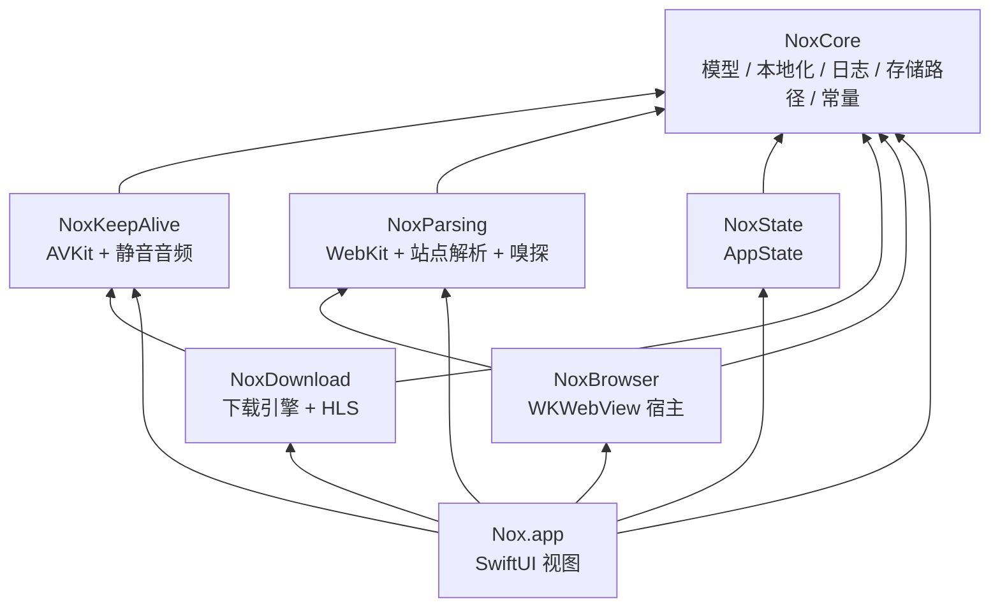

# Nox 模块化方案（SPM 单包多 target）

> 目标读者：接手本项目的 iOS 开发者
> 代码基线：`v1.3.2`（10,342 行 Swift / 26 个文件 / 1 个 app target / 0 个测试）
> 结论日期：2026-10-31

---

## 0. TL;DR

- **形态**：一个本地 Swift Package `NoxKit`，内含 **6 个 target**，而不是 6 个独立 package。工程文件只加一个本地包引用，模块边界由 SPM target 强制。
- **分层**：`NoxCore` 在最底；`NoxKeepAlive` / `NoxParsing` / `NoxState` 只依赖 Core；`NoxDownload` 依赖 Core + KeepAlive；`NoxBrowser` 依赖 Core + Parsing；App 依赖全部。依赖单向，无环。
- **关键动作**：把 `AppState` 从“被所有引擎依赖的具体类”改成“App 层实现的两个协议”，这是整件事的分水岭。
- **工期**：全量 **18–25 人日（3.5–5 周）**；只做到 `NoxCore + NoxKeepAlive + NoxParsing`（覆盖改得最频繁的部分）约 **7–9 人日**。
- **工作方式**：Linux 上只改代码（pbxproj 也是纯文本，可手改），编译验证全部交给 GitHub Actions。项目**没有测试**，CI 只能证明“编得过”，跑起来对不对仍要装 dev IPA 手测。

> 修正：上一轮口头估的“2–3 周”偏乐观。把文件拆分、协议倒置、访问级别改造和回归都算进去，全量 B 档是 3.5–5 周。

---

## 1. 现状事实

### 1.1 规模

| 指标 | 数值 |
|---|---|
| Swift 代码 | 10,342 行 / 26 文件 |
| 最大文件 | `DownloadManager.swift` 1633、`SettingsView.swift` 1064、`YouTubeParser.swift` 1023、`VideoBrowserView.swift` 1012、`AppState.swift` 790 |
| 第二轮最大 | `HLSDownloader.swift` 769、`KeepAlive/PictureInPictureKeepAlive.swift` 601、`VideoParser.swift` 514 |
| 顶层类型 | 约 70 个（另有大量嵌套类型） |
| 类型级成员声明 | 467 处（不含函数体内的局部变量） |
| `private` 成员 | 约 330 处，主要集中在 4 个大文件 |
| 测试 | 无 test target、无 XCTest 依赖 |
| 资源 | `Localizable.xcstrings`（5 语言）、`MediaSniffer.js`、`Assets.xcassets` |

### 1.2 现有依赖（实际观测）

```
AppState ──────────────► 所有文件（10 个文件引用）
DownloadManager ───────► AppState, KeepAliveCoordinator, HLSDownloader, DownloadStorage
KeepAliveCoordinator ──► AppState 的静态常量（defaultPiPWindowHeight 等）
VideoParser ───────────► AppState(isSiteEnabled), VideoSiteParserRegistry, SnifferBridge, SnifferScript
VideoSiteParser* ──────► VideoVariant / ParserError / LogStore / L()
HLSDownloader ─────────► DownloadStorage / ParserError / PreferredQuality（在 Sniffer 目录，但只被 DownloadManager 用）
Views ─────────────────► 全部
```

**已经比较干净的部分**：`Sniffer`（除 `HLSDownloader` 外零业务依赖）、`KeepAlive`（不引用具体业务类，只引用 AppState 静态常量）、`Parsers`（只依赖 Models + LogStore + L）。

**真正的结**：`AppState` 同时是设置中心、历史库、书签库、下载记录库和持久化入口，被 10 个文件引用。

### 1.3 五个硬约束

| # | 约束 | 影响 |
|---|---|---|
| C1 | `L()` / `AppLocale.bundle` 硬编码 `Bundle.main` | 字符串目录必须留在 app target，或改成 `Bundle.module` 兜底 |
| C2 | `SnifferScript.source()` 从 `Bundle.main` 读 `MediaSniffer.js` | 该 js 必须留在 app bundle |
| C3 | 无测试 | 每次改动只能手测，回归成本 = 总工期的 20–30% |
| C4 | 本机 Linux，无 `swiftc`/`xcodebuild` | 改动只能靠 Actions 验证；单次反馈 4–10 分钟，一轮改错 = 一轮等待 |
| C5 | `project.pbxproj` 手写（288 行、合成 ID） | 加 target / 包依赖必须人工编辑，易错 |

---

## 2. 目标架构

### 2.1 依赖图



要点：**6 个库 target 之间没有任何一个引用 `NoxState`**。`AppState` 只在 App target 里被接上，通过两个协议实现倒置。

### 2.2 模块职责

| target | 行数（估） | 依赖 | 职责 | 变化频率 |
|---|---|---|---|---|
| `NoxCore` | ~1,050 | Foundation / SwiftUI | 值类型模型、URL 扩展、`L()`、语言、日志、存储路径、默认常量、KeepAlive 选项枚举 | 低 |
| `NoxKeepAlive` | ~1,380 | Core + AVFoundation/AVKit/UIKit | 后台保活策略、PiP、共存保护 | 低 |
| `NoxParsing` | ~1,540 | Core + WebKit/CryptoKit | 站点解析协议与注册表、YouTube/Pornhub、嗅探桥与脚本 | **高** |
| `NoxDownload` | ~2,400 | Core + KeepAlive + UIKit | 任务队列、分片、HLS、探测、合并、缓存维护 | 中 |
| `NoxState` | ~400 | Core | `AppState`：设置 + 历史 + 书签 + 下载记录 + UserDefaults | 中 |
| `NoxBrowser` | ~560 | Core + Parsing + WebKit | `VideoParser`：WKWebView 宿主、导航状态、解析调度 | 中 |
| App | ~3,200 | 全部 | 所有 SwiftUI 视图 + 资源 + 组装 | 高 |

### 2.3 Package.swift

```swift
// swift-tools-version: 5.9
import PackageDescription

let package = Package(
    name: "NoxKit",
    platforms: [.iOS(.v17)],
    products: [
        .library(name: "NoxCore",      targets: ["NoxCore"]),
        .library(name: "NoxKeepAlive", targets: ["NoxKeepAlive"]),
        .library(name: "NoxParsing",   targets: ["NoxParsing"]),
        .library(name: "NoxDownload",  targets: ["NoxDownload"]),
        .library(name: "NoxState",     targets: ["NoxState"]),
        .library(name: "NoxBrowser",   targets: ["NoxBrowser"]),
    ],
    targets: [
        .target(name: "NoxCore"),
        .target(name: "NoxKeepAlive", dependencies: ["NoxCore"]),
        .target(name: "NoxParsing",   dependencies: ["NoxCore"]),
        .target(name: "NoxDownload",  dependencies: ["NoxCore", "NoxKeepAlive"]),
        .target(name: "NoxState",     dependencies: ["NoxCore"]),
        .target(name: "NoxBrowser",   dependencies: ["NoxCore", "NoxParsing"]),
    ]
)
```

不设 `defaultLocalization` —— 字符串目录留在 app target（见 §4.4）。

---

## 3. 文件划分明细

### 3.1 `NoxCore/Sources/NoxCore/`

| 目标文件 | 来源 | 行数 | 备注 |
|---|---|---|---|
| `Models/VideoVariant.swift` | `Models.swift` 3–25 | 23 | |
| `Models/PreferredQuality.swift` | `Models.swift` 26–68 | 43 | 用到 `L()` |
| `Models/ParserError.swift` | `Models.swift` 69–103 | 35 | `LocalizedError` |
| `Models/DownloadRecord.swift` | `Models.swift` 104–197 | 94 | 含 `DownloadStatus` |
| `Models/TransferStats.swift` | `Models.swift` 198–287 | 90 | 日期/数字格式化，用 `AppLocale` |
| `Models/HistoryItem.swift` | `Models.swift` 288–295 | 8 | |
| `Models/Bookmark.swift` | `Models.swift` 296–317 | 22 | |
| `Models/URL+Query.swift` | `Models.swift` 318–362 | 45 | 现有 `extension URL` |
| `Models/ParsedVideo.swift` | `Models.swift` 363–367 | 5 | |
| `Models/KeepAliveOptions.swift` | `KeepAlive/KeepAliveMode.swift` 全量 | 69 | 3 个枚举下沉到 Core，避免 `NoxState → NoxKeepAlive` |
| `Storage/DownloadStorage.swift` | `DownloadManager.swift` 16–130 | 115 | 路径工具 |
| `Storage/DownloadSegment.swift` | `DownloadManager.swift` 8–15 | 8 | |
| `Config/NoxDefaults.swift` | `AppState.swift` 6–36 / 65–74 | ~40 | 见 §4.1 |
| `Localization/Localized.swift` | `AppState.swift` 400–451 | ~52 | `AppLocale` + 全局 `L()` |
| `Localization/AppLanguage.swift` | `AppState.swift` 452–475 | 24 | |
| `Localization/LocalizationManager.swift` | `AppState.swift` 476–499 | 24 | |
| `Localization/HistoryRetentionMode.swift` | `AppState.swift` 500–516 | 17 | |
| `Localization/AppearanceMode.swift` | `AppState.swift` 517–542 | 26 | |
| `Logging/LogLevel.swift` | `AppState.swift` 543–558 | 16 | |
| `Logging/LogEntry.swift` | `AppState.swift` 559–572 | 14 | |
| `Logging/LogStore.swift` | `AppState.swift` 573–790 | 218 | 单例 + 落盘 |

### 3.2 `NoxKeepAlive/Sources/NoxKeepAlive/`

| 目标文件 | 来源 | 行数 | 备注 |
|---|---|---|---|
| `KeepAliveStrategy.swift` | 同名文件 | 39 | 协议 + `KeepAliveError` |
| `KeepAliveCoordinator.swift` | 同名文件 | 292 | 改 `AppState.defaultPiPWindowHeight` → `NoxDefaults` |
| `PictureInPictureKeepAlive.swift` | 同名文件 | 601 | 同上 |
| `SilentAudioKeepAlive.swift` | 同名文件 | 86 | |
| `PiPCoexistenceProtection.swift` | 同名文件 | 366 | ObjC runtime，保持 internal |

### 3.3 `NoxParsing/Sources/NoxParsing/`

| 目标文件 | 来源 | 行数 | 备注 |
|---|---|---|---|
| `VideoSiteParser.swift` | `Parsers/VideoSiteParser.swift` 9–40 | 32 | 协议 |
| `WebPageContext.swift` | 同文件 41–114 | 74 | 协议 + `WKWebPageContext` |
| `MediaResourceLoader.swift` | 同文件 115–152 | 38 | |
| `MediaManifestDecoder.swift` | 同文件 153–181 | 29 | |
| `VideoSiteParserRegistry.swift` | 同名文件 | 31 | `.default` 注册表 |
| `SiteAvailabilityProviding.swift` | **新增** | ~8 | 见 §4.2 |
| `YouTube/YouTubeParser.swift` | `YouTubeParser.swift` 1–177 | ~177 | 编排 + 多来源回退 + 视频 ID |
| `YouTube/PlayerData.swift` | 同文件 178–258 | ~80 | 页面播放器数据 / 风控判定 |
| `YouTube/PageScripts.swift` | 同文件 259–320 | ~62 | 注入脚本常量 |
| `YouTube/InnerTubeClient.swift` | 同文件 321–799 | ~480 | 客户端 profile / 请求 / SAPISIDHASH / decipher |
| `YouTube/StreamExtraction.swift` | 同文件 800–1023 | ~224 | 直链捕获 + 格式 → variants |
| `Pornhub/PornhubParser.swift` | 同名文件 | 89 | |
| `Sniffer/SnifferScript.swift` | 同名文件 | 35 | 仍读 `Bundle.main` |
| `Sniffer/SnifferBridge.swift` | 同名文件 | 145 | 单例 `ObservableObject` |
| `Sniffer/GenericSnifferParser.swift` | 同名文件 | 38 | 实现 `VideoSiteParser` |

> 注 1：`HLSDownloader.swift` **不进**本模块（见 §4.3）。
> 注 2：`YouTubeParser` 的切分是**按连续行区间**搬移，纯文件操作，不改逻辑；`PageScripts.swift` 里是 3 段多行字符串字面量。

### 3.4 `NoxDownload/Sources/NoxDownload/`

| 目标文件 | 来源 | 行数 | 备注 |
|---|---|---|---|
| `DownloadManager.swift` | `DownloadManager.swift` 131–520 + 693–740 | ~450 | 公开 API、生命周期、任务调度 |
| `DownloadStateStore.swift` | **新增** | ~30 | 见 §4.2 |
| `Queue/TaskQueue.swift` | 同文件 693–850 | ~160 | 队列 / 槽位 / 启动 |
| `Queue/SegmentScheduler.swift` | 同文件 850–975 | ~130 | 分片调度 |
| `Transfer/ProgressTracker.swift` | 同文件 976–1080 | ~110 | 定时器 + `SpeedMeter` |
| `Transfer/SegmentCompletion.swift` | 同文件 1080–1192 | ~120 | URLSession delegate + 完成判定 |
| `Transfer/FileAssembly.swift` | 同文件 1192–1295 | ~110 | 合并 / 暂存 / 落盘 |
| `Transfer/RemoteProbe.swift` | 同文件 1408–1496 | ~90 | Range 探测 / 总大小 |
| `Transfer/FileNaming.swift` | 同文件 1496–1547 | ~50 | 文件名 |
| `Transfer/Failure.swift` | 同文件 1547–1633 | ~90 | abort / 完成日志 |
| `Maintenance/CacheMaintenance.swift` | 同文件 516–692 | ~180 | 缓存统计 / 清理 / 网站数据 |
| `HLS/HLSDownloader.swift` | `Sniffer/HLSDownloader.swift` 296–769 | ~475 | 从 Sniffer 迁入 |
| `HLS/HLSPlaylist.swift` | 同文件 6–201 | ~200 | |
| `HLS/HLSCrypto.swift` | 同文件 202–295 | ~95 | `CommonCrypto` |
| `Support/SpeedMeter.swift` | `SpeedMeter.swift` 全量 | 86 | 只被下载引擎使用，随 `NoxDownload` 走 |

> `DownloadManager` 拆成 12 个文件，但仍是**一个类型 + 多个 `extension`**，行为零改动。

### 3.5 `NoxState/Sources/NoxState/`

| 目标文件 | 来源 | 行数 |
|---|---|---|
| `AppState.swift` | `AppState.swift` 5–399 去掉已下沉的枚举/日志 | ~330 |
| `AppState+Persistence.swift` | `AppState.swift` 262–399 | ~140 |

`AppState` 保留 22 个 `@Published`、全部设置项和 UserDefaults 逻辑，其他一律搬走。

### 3.6 `NoxBrowser/Sources/NoxBrowser/`

| 目标文件 | 来源 | 行数 |
|---|---|---|
| `VideoParser.swift` | `VideoParser.swift` 7–285 + 456–475 | ~300 |
| `VideoParser+Bridges.swift` | 同文件 476–514 | ~40 |
| `Scripts/PageURLScript.swift` | 同文件 286–373 | ~90 |
| `Scripts/YouTubeMediaScript.swift` | 同文件 374–455 | ~85 |

> 两段脚本现在是类里的 `private static func`，搬出去时要改成 `internal`，属于纯搬移。

### 3.7 App target（`Nox/`）

| 目标路径 | 来源 | 行数 |
|---|---|---|
| `NoxApp.swift` | 原样 | 13 |
| `AppWiring.swift` | **新增**（协议实现） | ~10 |
| `ContentView.swift` | 原样 | 55 |
| `Resources/Localizable.xcstrings` | 移动 | — |
| `Resources/MediaSniffer.js` | 移动 | — |
| `Resources/Assets.xcassets` | 移动 | — |
| `Views/Browser/VideoBrowserView.swift` | `VideoBrowserView.swift` 5–183 | ~180 |
| `Views/Browser/AddressBar.swift` | 同文件 184–389 | ~205 |
| `Views/Browser/StartPage.swift` | 同文件 390–484 | ~95 |
| `Views/Browser/FloatingEntries.swift` | 同文件 485–594 | ~110 |
| `Views/Browser/ParsePanel.swift` | 同文件 595–657 | ~63 |
| `Views/Browser/BrowserActions.swift` | 同文件 658–879 | ~220 |
| `Views/Browser/ParseVariantRow.swift` | 同文件 880–916 | ~37 |
| `Views/Browser/GlassStyle.swift` | 同文件 917–950 | ~34 |
| `Views/Browser/WebViewContainer.swift` | 同文件 951–1012 | ~62 |
| `Views/Downloads/DownloadsView.swift` | `DownloadsView.swift` 4–213 | ~210 |
| `Views/Downloads/DownloadRow.swift` | 同文件 214–379 | ~165 |
| `Views/Downloads/SharePresenter.swift` | 同文件 380–414 | ~35 |
| `Views/History/HistoryView.swift` | `HistoryView.swift` 4–207 | ~205 |
| `Views/History/TwoFingerPanToSelect.swift` | 同文件 208–447 | ~240 |
| `Views/Settings/SettingsView.swift` | `SettingsView.swift` 5–195 | ~190 |
| `Views/Settings/LicensesView.swift` | 同文件 196–257 | ~60 |
| `Views/Settings/DownloadSettingsView.swift` | 同文件 258–326 | ~70 |
| `Views/Settings/KeepAliveSettingsView.swift` | 同文件 327–433 | ~105 |
| `Views/Settings/SiteSettingsView.swift` | 同文件 434–507 | ~75 |
| `Views/Settings/StorageSettingsView.swift` | 同文件 508–709 | ~200 |
| `Views/Settings/HistorySettingsView.swift` | 同文件 710–770 | ~60 |
| `Views/Settings/LogsView.swift` | 同文件 771–900 | ~130 |
| `Views/Settings/CookieManager.swift` | 同文件 901–964 | ~65 |
| `Views/Settings/CookiesView.swift` | 同文件 965–1064 | ~100 |
| `Views/Sniffer/SnifferSheet.swift` | `Sniffer/SnifferSheet.swift` | 168 |

> ⚠️ 与 §3.1–3.6 不同，**视图的拆分不是纯搬移**：现有 View 把地址栏、首页、解析面板都写成同一个 `struct` 的 computed property，抽出去要改成独立子 `View` 并显式传 `@Binding` / 回调。这是 P6 的主要工作量，也是唯一可能引入 UI 行为差异的阶段。也可以只拆文件（`private extension` 留在同文件），先不抽子视图。

---

## 4. 必须动的 6 处结构性代码

### 4.1 静态常量从 `AppState` 迁到 `NoxDefaults`

现在 `KeepAlive` 和 `Download` 直接引用 `AppState.segmentCountRange`、`AppState.defaultPiPWindowHeight` 等 —— 这会让两个引擎反向依赖状态类。改为：

```swift
// NoxCore/Config/NoxDefaults.swift
public enum NoxDefaults {
    public static let segmentCountRange = 1...32
    public static let unlimitedConcurrentDownloads = 0
    public static let maxConcurrentDownloadsOptions = [1, 3, 5, 10, 20, unlimitedConcurrentDownloads]
    public static let defaultHLSConcurrency = 4
    public static let maxHLSConcurrency = 32
    public static let defaultPiPWindowHeight: Double = 0
    public static let minimizedPiPWindowHeight: Double = 0.1
    // …
}
```

影响面：`SettingsView` 7 处、`DownloadManager` 5 处、`PictureInPictureKeepAlive` 2 处、`KeepAliveCoordinator` 1 处。纯替换。

### 4.2 两个边界协议（本次改造的核心）

**下载侧**（`NoxDownload` 定义，App 层实现）：

```swift
@MainActor
public protocol DownloadStateStore: AnyObject {
    var downloads: [DownloadRecord] { get set }
    /// DownloadManager 需要订阅变化来驱动后台保活，因此必须暴露 publisher
    var downloadsPublisher: AnyPublisher<[DownloadRecord], Never> { get }

    var preferredQuality: PreferredQuality { get }
    var experimentalMultiThreadDownload: Bool { get }
    var multiThreadSegmentCount: Int { get }
    var m3u8SegmentConcurrency: Int { get }
    var maxConcurrentDownloads: Int { get }

    var keepAliveMode: KeepAliveMode { get set }
    var keepAliveLifetime: KeepAliveLifetime { get set }
    var pipCoexistenceFallback: PiPCoexistenceFallback { get set }
    var pipWindowHeight: Double { get set }
    var pipVerboseLogging: Bool { get set }

    func addDownload(_ record: DownloadRecord)
    func updateDownload(_ record: DownloadRecord, persist: Bool)
    func removeDownload(_ record: DownloadRecord)
    func clearFinishedDownloads()
    func addHistory(title: String, url: URL)
    func persist()
}
```

> ⚠️ 现有代码第 259 行用的是 `appState.$downloads` 投影，协议无法直接暴露 `@Published`，所以上面单独给了 `downloadsPublisher`。这是最容易漏掉的一处。

**解析侧**（`NoxParsing` 定义）：

```swift
@MainActor
public protocol SiteAvailabilityProviding: AnyObject {
    func isSiteEnabled(_ identifier: String) -> Bool
}
```

**App 层组装**（`Nox/AppWiring.swift`）：

```swift
import NoxCore
import NoxDownload
import NoxParsing
import NoxState

@MainActor
extension AppState: DownloadStateStore, SiteAvailabilityProviding {
    public var downloadsPublisher: AnyPublisher<[DownloadRecord], Never> {
        $downloads.eraseToAnyPublisher()
    }
}
```

`VideoParser.init` 与 `DownloadManager.init` 的入参分别改成 `sites:` / `store:`。调用点只有 3 处（`ContentView`、`VideoBrowserView`）。

### 4.3 `HLSDownloader` 从 `Sniffer` 迁到 `NoxDownload`

它放在 `Sniffer/` 下，但唯一调用方是 `DownloadManager`（`SnifferBridge` 里只是注释提到）。留在 `NoxParsing` 会制造 `Parsing → Download` 的假依赖，必须搬走。

### 4.4 资源留在 app bundle

三个资源全部留在 App target：

- `Localizable.xcstrings` → `L()` 继续用 `Bundle.main`，**零改动**。
- `MediaSniffer.js` → `SnifferScript` 继续 `Bundle.main`，**零改动**。
- `Assets.xcassets` → 本来就只能属于 app。

代价：`NoxKit` 不能脱离这个 App 复用。若将来要给扩展/第二个 App 用，再改成：

```swift
public enum NoxLocalization {
    public static var bundle: Bundle = .main   // App 启动时可指向 Bundle.module
}
```
并把 `defaultLocalization: "en"` 加进 `Package.swift`。**本次不做**，避免 5 种语言的资源打包返工。

### 4.5 `private` → `internal` 的机械改造

拆分 `DownloadManager` 需要把约 **35 个 `private` 成员**放宽到 `internal`（同一模块内跨文件可见）。注意：

- `private static let segmentLength` 等常量也会被多个 extension 用到。
- 拆完后建议把确实只在一个文件用的再收回 `private`，避免模块内耦合反弹。

### 4.6 工程文件改造（纯文本，Linux 可改，CI 验证）

现状对模块化很不友好：`project.pbxproj` 把 **29 个文件逐条列出**（29 条 `PBXBuildFile` + 29 条 `PBXFileReference` + 3 个 `PBXGroup` + Sources/Resources 的 `files` 列表）。后面要搬 20 多个文件、新建 40 多个文件，如果继续逐条维护，每次 push 都在赌 pbxproj 没写错。

好消息：工程已经是 `objectVersion = 77` / `compatibilityVersion = "Xcode 26.0"`，**支持目录同步组**（`PBXFileSystemSynchronizedRootGroup`，Xcode 16+）。改造后新增/移动/删除源文件**完全不用改 pbxproj**，这是后续所有阶段能在 Linux 上完成的前提。

**P0 一次性步骤（单独一个 PR，不做任何文件搬移）：**

1. `PBXGroup` 段删掉 `E10000010000000000000002 /* Nox */`，换成：

```text
/* Begin PBXFileSystemSynchronizedRootGroup section */
        E10000010000000000000002 /* Nox */ = {
            isa = PBXFileSystemSynchronizedRootGroup;
            path = Nox;
            sourceTree = "<group>";
        };
/* End PBXFileSystemSynchronizedRootGroup section */
```

2. `PBXNativeTarget` 里加一行：`fileSystemSynchronizedGroups = (E10000010000000000000002,);`
3. 根组 `E100...01` 的 `children` 继续保留 `E100...02`（它现在是同步组，不再是 `PBXGroup`）。
4. 删除 29 条 `PBXBuildFile`、29 条 `PBXFileReference`，以及 `PBXSourcesBuildPhase.files` / `PBXResourcesBuildPhase.files` 里的对应条目。**漏删一条会报 `Build input file cannot be found`**——属于 CI 能立刻抓到的错误。
5. 加本地包引用：一条 `XCLocalSwiftPackageReference`（`relativePath = NoxKit`）+ 6 条 `XCSwiftPackageProductDependency`，写进 `PBXFrameworksBuildPhase.files`。

**CI 必须断言资源，不能只看编译通过：**

```bash
APP=build/DerivedData/Build/Products/Debug-iphoneos/Nox.app
test -f "$APP/MediaSniffer.js"   || { echo "::error::MediaSniffer.js missing"; exit 1; }
test -d "$APP/zh-Hans.lproj"     || { echo "::error::zh-Hans.lproj missing"; exit 1; }
test -d "$APP/en.lproj"          || { echo "::error::en.lproj missing"; exit 1; }
```

原因：同步组按文件类型自动分配构建阶段。`.js` 和 `.xcstrings` 一旦没被识别为资源，**编译照样通过，但运行时嗅探静默失效、多语言退回开发语言**。这是 P0 唯一真正的坑，必须用断言挡住。

> 回退方案：若同步组在 Xcode 26 上表现异常，退回逐条维护 `PBXFileReference`，但那样每个阶段的文件搬移都要额外改 pbxproj，工期 +30%。

---

## 5. 分阶段落地

### 5.0 Actions 驱动的改造节奏

现有两个 workflow：

| workflow | 触发 | 做什么 |
|---|---|---|
| `build-dev.yml` | push 到 `dev`（忽略 `VERSION`）或手动 | 编译 + 打无签名 IPA + 上传工件 |
| `build-and-release.yml` | PR 合并到 `main` | 编译 + 打 IPA + 发 Release |

改造期建议**新增一个只编译的 workflow**，把反馈时间压到最短：

```yaml
name: Build check

on:
  push:
    branches: [ dev, 'refactor/**' ]
    paths-ignore: [ VERSION, 'docs/**', '*.md' ]
  workflow_dispatch:

permissions:
  contents: read

concurrency:
  group: build-check-${{ github.ref }}
  cancel-in-progress: true

jobs:
  build:
    runs-on: macos-26
    steps:
      - uses: actions/checkout@v4
      - uses: maxim-lobanov/setup-xcode@v1
        with:
          xcode-version: '26.6'
      - name: Build
        run: |
          set -o pipefail
          xcodebuild \
            -project Nox.xcodeproj -scheme Nox -sdk iphoneos \
            -configuration Debug -destination 'generic/platform=iOS' \
            -derivedDataPath build/DerivedData \
            CODE_SIGNING_ALLOWED=NO CODE_SIGNING_REQUIRED=NO \
            -quiet build
      - name: Resource smoke check
        run: |
          APP=build/DerivedData/Build/Products/Debug-iphoneos/Nox.app
          test -d "$APP"                              || { echo "::error::Nox.app missing"; exit 1; }
          test -f "$APP/MediaSniffer.js"              || { echo "::error::MediaSniffer.js missing"; exit 1; }
          test -d "$APP/zh-Hans.lproj"                 || { echo "::error::zh-Hans.lproj missing"; exit 1; }
          test -d "$APP/en.lproj"                      || { echo "::error::en.lproj missing"; exit 1; }
```

配套规则：

1. **一次 push 只做一件事**。搬文件和改访问级别分开提交，否则编译器错误会互相淹没。
2. **每次 push 必须保持可编译**。不要把一个阶段的中间态留在远端过夜。
3. Linux 上取结果：`gh run watch` / `gh run view --log-failed`。
4. P0 第一次跑完，把耗时记下来，作为后续每个 PR 的时间预算。
5. **不改 `VERSION`**。`v1.3.2` 的 tag 已存在，合并到 `main` 时 `build-and-release.yml` 会在 “Check existing tag” 处跳过发布，重构 PR 不会误发版。

### 5.1 阶段表

每阶段一个 PR，独立可回滚；每阶段结束 App 必须能跑。

| 阶段 | 内容 | 验收 | 工期 |
|---|---|---|---|
| **P0 骨架** | 同步组迁移 + 建 `NoxKit` 空包 + 1 个空 target + 新 CI；**不搬任何文件** | CI 绿 + 三条资源断言通过 | 0.5–1 天（2–3 轮 CI） |
| **P1 Core** | 搬 `Models`/`L()`/`LogStore`/`DownloadStorage`/常量；`public` 标注 | App 全功能手测通过 | 2–3 天 |
| **P2 KeepAlive** | 搬 5 个文件；常量替换 | 保活/PiP/共存保护三条路径手测 | 1–1.5 天 |
| **P3 Parsing** | 搬解析 + 嗅探；拆 `YouTubeParser` 为 5 文件 | 三个站点解析 + 嗅探 + 日志页 | 3–4 天 |
| **P4 Download** | 搬 `DownloadManager` + `HLSDownloader`；拆 12 文件；引入 `DownloadStateStore` | 断点续传 / 多线程 / m3u8 / 取消重试 | 4–6 天 |
| **P5 State + Browser** | 搬 `AppState`、`VideoParser`；引入 `SiteAvailabilityProviding` | 地址栏、SPA 换页、书签、历史 | 2–3 天 |
| **P6 App UI** | 视图按目录重组拆文件（行为不变） | 全界面点一遍 | 2–3 天 |
| **P7 回归** | 全量手测矩阵 + 修漏 | 见 §8 | 3–4 天 |
| | | **合计** | **18–25 天** |

**可提前收工的切点**：做完 P3 就获得了 Core / KeepAlive / Parsing 的编译期边界——这三块是改动最频繁、最需要隔离的。此时已投入约 7–9 天，剩下的收益递减。

**不建议跳步**：P4 依赖 P1+P2；P5 依赖 P4（协议）。

---

## 6. 风险与对策

| 风险 | 概率 | 影响 | 对策 |
|---|---|---|---|
| pbxproj 手工编辑出错，工程打不开 | 中 | 高 | P0 单独一个 PR，在 Mac 上做；保留旧 pbxproj 备份；先只加空 target |
| 访问级别改造遗漏（约 250–300 处） | 高 | 中 | 编译器逐个报错，属于机械工作；按模块逐个 `public`，不要一次全改 |
| `@Published` 投影无法进协议 | 已确认 | 中 | §4.2 的 `downloadsPublisher` |
| 资源找不到（xcstrings / js） | 低 | 中 | 本次资源不动，保持 `Bundle.main` |
| 无测试导致回归漏网 | 高 | 高 | P7 单独留 3–4 天；至少手测矩阵覆盖：断点续传、取消后重试、HLS、保活三模式、语言切换、深色模式 |
| 只能用 CI 编译，单次反馈 4–10 分钟 | 确定 | 中 | 小步 push；一次只改一件事；`gh run view --log-failed` 取错误；P0 测出基线耗时 |
| 同步组静默丢资源（编译过、运行时坏） | 中 | 高 | §4.6 的三条资源断言必须进 CI |
| pbxproj 手改漏删引用 | 中 | 中 | P0 单独 PR，不做文件搬移；失败信息明确（Build input file cannot be found） |
| `@MainActor` 协议与 Swift 5 模式 | 低 | 低 | 保持 Swift 5 语言模式，不改 strict concurrency |
| PiP 的 ObjC runtime 私有调用跨模块失效 | 低 | 高 | `PiPCoexistenceProtection` 保持 `internal`，只搬文件不改实现；P2 单独验证 |

---

## 7. 明确不做的事

1. **不拆成 6 个独立 package**。一个 `NoxKit` + 6 个 target 已经把边界锁死了，独立 package 只会让版本管理和 pbxproj 更痛。
2. **不把 UI 放进模块**。`SnifferSheet`、`SettingsView` 等留在 App target。UI 变化快，模块化收益低、`public` 成本高。
3. **不把 `Localizable.xcstrings` 移进包**。5 种语言 + 资源 bundle + `Bundle.main` 改造，纯风险无收益。
4. **不在同一次改造里上 Swift 6 严格并发**。两件事叠在一起，出问题无法定位。
5. **不为了模块化而重写 `AppState`**。本方案只让它实现协议，不拆分它的字段。拆分 Store 是 C 档（4–8 周），可后续单独做。
6. **不建微模块**。`DownloadStorage` 这类 100 行以内的小东西并入 `NoxCore`，`SpeedMeter` 并入 `NoxDownload`，都不单独成 target。

---

## 8. 验收清单

编译与结构：

- [ ] `xcodebuild -scheme Nox -destination 'generic/platform=iOS' CODE_SIGNING_ALLOWED=NO build` 通过
- [ ] 产物内含 `MediaSniffer.js` 与全部 5 个 `.lproj`（见 §4.6 断言）
- [ ] 6 个 target 的依赖方向与 §2.1 一致（`NoxState` 不被任何库引用）
- [ ] 无 `@_exported import`、无跨模块 `internal` 偷渡
- [ ] `NoxKit` 内没有 `Bundle.main` 资源查找（除已声明的 `MediaSniffer.js` / `L()`）

功能（手测矩阵）：

- [ ] 浏览器：地址栏输入 / 前进后退 / 下拉刷新 / SPA 换页进度条 / 书签增删改
- [ ] 解析：YouTube（正常 / 风控 / 需解密）、Pornhub、Sniffer 三者互斥显示
- [ ] 下载：Range 探测、分片续传、取消后重试、1–32 线程、并发 1/3/5/10/20/无限
- [ ] HLS：m3u8 合并、加密分片、进度与速度
- [ ] 保活：关闭 / 静音音频 / 画中画 + 共存保护 + 跟随任务 / 常驻
- [ ] 设置：5 种语言切换即时生效、深色模式、缓存清理、Cookie 管理、日志导出
- [ ] 冷启动恢复：未完成任务、已完成但文件缺失的提示

---

## 9. 附：本次评估的量化依据

| 结论 | 依据 |
|---|---|
| `AppState` 是唯一强耦合点 | 10 个文件引用；22 个 `@Published`；`DownloadManager` 读写 15 个属性 |
| 下载侧协议面可控 | `DownloadManager` 对外仅 32 个成员 + `appState` 的 22 个访问点 |
| 解析侧已经很干净 | `Parsers` 只依赖 4 个 Core 类型 |
| 拆文件成本集中在私有成员 | 4 个大文件共约 230 处 `private` |
| 访问级别改造量 | 467 处类型级成员声明，跨模块实际需要 `public` 的约 250–300 处 |
| 回归是最大不确定项 | 0 个测试 target，功能点覆盖下载/解析/保活/浏览器四条主链 |


---

## 10. 实施记录（本次已落地）

按本文档一次性完成了 P0–P6 的代码改造，未在本机编译（Linux），以下为改动清单：

### 10.1 新增

| 路径 | 说明 |
|---|---|
| `NoxKit/Package.swift` | 6 个 target，依赖方向见 §2.1 |
| `NoxKit/Sources/NoxCore/**` | 21 个文件：模型、本地化、日志、存储路径、默认常量、KeepAlive 选项 |
| `NoxKit/Sources/NoxKeepAlive/**` | 5 个文件，原 `Nox/KeepAlive/` |
| `NoxKit/Sources/NoxParsing/**` | 14 个文件，原 `Nox/Parsers/` + `Nox/Sniffer/` |
| `NoxKit/Sources/NoxDownload/**` | 13 个文件：`DownloadManager` 拆 8 个 + `HLSDownloader` 拆 3 个 + 协议 + SpeedMeter |
| `NoxKit/Sources/NoxState/AppState.swift` | 原 `AppState` 类本体 |
| `NoxKit/Sources/NoxBrowser/**` | `VideoParser` + 两段注入脚本 + 两个桥接 |
| `Nox/AppWiring.swift` | `AppState` 对两个边界协议的实现 |
| `Nox/Views/**` | 25 个视图文件（原 4 个大文件拆开，改为 `extension`，行为不变） |
| `Nox/Resources/**` | 字符串目录、嗅探脚本、Asset Catalog |
| `.github/workflows/build-check.yml` | 只编译 + 资源断言 |

### 10.2 结构性改动

1. `NoxDefaults` 成为常量唯一来源；`AppState` 保留同名 `public static let` 别名，视图代码零改动。
2. `DownloadManager.init(store: DownloadStateStore)`；内部 `appState` 全部改为 `store`。
3. `VideoParser.init(sites: SiteAvailabilityProviding)`；`appState.isSiteEnabled` 改为协议调用。
4. `DownloadManager` 需要订阅记录变化，因此 `DownloadStateStore` 暴露 `downloadsPublisher`，实现放在 `AppState` 内（`$downloads.eraseToAnyPublisher()`）。
5. `transfers` 改为 `public internal(set)`：分片/进度/组装分散在不同文件，但仍不允许 App 层写入。
6. `HLSDownloader` 从 `Sniffer/` 迁到 `NoxDownload/HLS/`。
7. `GenericSnifferParser` 保持模块内可见；视图需要的标识单独抽出 `SnifferSite.identifier`。
8. `project.pbxproj` 改为 `PBXFileSystemSynchronizedRootGroup`，文件列表全部删除；新增 1 个本地包引用 + 6 个产品依赖。

### 10.3 上线前必须在 CI/真机确认

- [ ] `build-check` 首次运行通过（pbxproj 语法 + 模块可见性）
- [ ] `Nox.app` 内含 `MediaSniffer.js`、`Assets.car` 与 `en/ko/fr/de.lproj`；`zh-Hans` 只要求出现在 `CFBundleLocalizations`（源语言不生成 lproj）
- [ ] 真机安装 dev IPA 后手测：解析三个来源、断点续传、m3u8、保活三模式、语言切换
- [ ] 若同步组漏掉 `.js` 或 `.xcstrings`，按 §4.6 的回退方案改为显式 `PBXFileReference`

### 10.4 已知的「编译期可能暴露」的点

| 可能报错 | 原因 | 处理 |
|---|---|---|
| `cannot find type 'X' in scope` | 某文件少 `import NoxXxx` | 按报错补 import |
| `method must be declared public` | public 类型实现了 public 协议 | 已处理：`WKScriptMessageHandler` / `WKNavigationDelegate` / `URLSessionDownloadDelegate`；若还有遗漏，按报错加 `public` |
| `initializer is inaccessible` | 跨模块构造 public struct | 已为 6 个模型加显式 `public init`；若还有，补 `public init` |
| `cannot find 'store' / 'sites'` | 初始化参数改名 | 已同步 3 处调用点 |
| `initializer is inaccessible due to 'private' protection level` | struct 带 `private` 存储属性时，合成的 memberwise init 也是 private；拆文件后跨文件构造会失败 | 已为 `DownloadRow` / `SnifferSheet` / `SpeedMeter` 增加显式 internal init，其余同类按报错补 |
| `cannot find type 'Published' / 'ObservableObject'` | 文件只 import 了 WebKit/Foundation，没有 Combine | 已补 `VideoParser.swift`、`SnifferBridge.swift` 的 `import Combine` |
| `cannot find 'WKWebsiteDataStore'` | `DownloadStorage` 拆到 NoxCore 后漏了 WebKit | 已补 `import WebKit` |
| 同步组未包含资源 | `.js` / `.xcstrings` 分类异常 | 实测 `MediaSniffer.js` 与 4 个翻译 lproj 均在包内；`zh-Hans` 是源语言，不生成 lproj |

### 10.5 本机静态检查（非编译）

- 全部 Swift 文件大括号平衡；
- 原 `HEAD` 中每个类型/函数/属性名与字符串字面量都能在新树中找到（仅 `siteIdentifier` 有意替换为 `SnifferSite.identifier`）；
- 跨文件 `private` / `fileprivate` 成员、顶层 `private` 类型已脚本排查，无残留；
- App 层引用的各模块类型/成员均已 `public`；`AppState` 对两个边界协议的 witness 齐全。

以上只能降低 CI 首轮报错量，**不代表已编译通过**；最终以 `build-check` 结果为准。

### 10.6 CI 首轮结果（2026-10-31）

- `Build (dev)` run `41190277429`（提交 `96d3e84`）**编译 + 打包成功**。
- 实际 IPA 内含：`MediaSniffer.js`、`Assets.car`、`en/ko/fr/de.lproj`、`Nox`、`Info.plist`。
- `zh-Hans.lproj` 不存在；改造前的 IPA 同样不存在。原因是 `zh-Hans` 为 string catalog 的 `sourceLanguage`，源语言文本就是 key。已据此修正 `build-check.yml` 的断言（改为检查 `CFBundleLocalizations`）。
- 顺带修复一个旧 bug：系统英文 + App 内选简体中文时，`L()` 回落到 `Bundle.main` 会命中 `en.lproj`，界面显示英文。现在源语言且无 `zh-Hans.lproj` 时直接返回 key。
